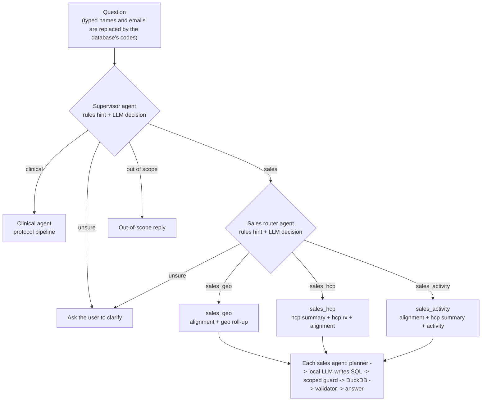

# Architecture: a local, hierarchical multi-agent pipeline for pharma analytics

Everything runs on one machine (Docker, Ollama, DuckDB, Phoenix). No data leaves it, and personal names never reach the model or the traces.



## The agents and what each may touch

| Agent | Tables | Relations it may query |
|---|---|---|
| sales_geo | territory_alignment_hierarchy, rx_report_summary_geo | territory_alignment_hierarchy, v_geo_latest, v_geo_trend |
| sales_hcp | hcp_summary_with_territory_and_tm_info, hcp_rx_summary_report, territory_alignment_hierarchy | hcp summary, alignment, v_hcp_rx_latest, v_hcp_rx_trend |
| sales_activity | territory_alignment_hierarchy, hcp_summary_with_territory_and_tm_info, hcp_activity_calls_vae_suggestions | alignment, hcp summary, v_activity_latest |

The restriction is enforced in code, not only in the prompt: each agent has its own planner scope, its own prompt (only its relations and join rules) and its own SQL guard, which rejects any other relation. `tests/test_agents_config.py` checks that no view reads a table outside its agent's list.

## How routing works

1. **Rules** give a hint (route plus "strong" or "weak"): file paths and protocol words for clinical, metric and geography words for sales, unsupported topics (payer, claims, call notes, market share...) for out of scope.
2. **The LLM** returns a route, a confidence and a reason (JSON). Both are logged in Phoenix.
3. **Decision rule:** agree -> go. Disagree and the rules are strong -> rules win (logged as `rules_override`). Disagree and the rules are weak -> the LLM wins if confidence is at least 0.6 (`llm_override`), otherwise the system asks you to clarify.
4. `ROUTER_MODE` = `hybrid` (default, LLM always asked), `fast` (LLM only when rules are unsure), `rules` (no LLM), `llm` (no rules).

## Joins

`scripts/discover_joins.py` tests candidate keys on the real data and writes `joins.yml`. A join is approved only if it cannot multiply rows. Where the "one" side holds numbers, only a semi-join (`WHERE key IN (SELECT ...)`) is allowed. Joins you remove are listed in `joins_overrides.yml` and stay removed when discovery is re-run. The guard rejects any JOIN that is not approved or does not use the approved key columns. The geo agent has no join at all (the alignment-to-geo join was removed); it finds a territory manager's territory with a lookup subquery.

## What this is, honestly

A supervisor-worker system on LangGraph. The routers are hybrid (rules plus a small local LLM). The worker agents are mostly deterministic: a planner resolves the metric, grain, level, filters and a query template, and the local LLM completes the SQL, which a parser-based guard checks before DuckDB runs it. Report the ablation (`PROMPT_MODE=template` is planner only, `facts` is facts only, `full` is facts plus template) so the contribution of each layer is clear.

## Measured results (fill in from your runs)

| Measure | Result |
|---|---|
| Routing, rules only (dev / hold-out) | 100% / 96% supervisor, 100% / 94% sales router (dev rules were designed on it; hold-out written by the same author) |
| Routing, hybrid (hold-out) | |
| SQL accuracy per agent (direct), dev / hold-out | |
| Single agent with all tables vs routed hierarchy | |
| Ablation: template / facts / full | |

## Run it

```bash
docker compose run --rm app python -m app.cli ask --explain "Which area has the least NBRx in the latest month for the Neuro division?"
docker compose run --rm app python -m app.agents.route_eval --file data/evals/routing_holdout.yaml --mode hybrid
docker compose run --rm app python -m app.sales.eval            # each question straight to its own agent
docker compose run --rm app python -m app.sales.eval --e2e      # through the supervisor and sales router
docker compose run --rm app python -m app.sales.eval --single   # one agent with all tables, for comparison
```

## Limitations

- One agent answers one question. Questions that need two agents are not combined.
- Synthetic data, a small local model, and a rule-based planner mean accuracy figures describe this setup only.
- NTS is not defined in the datasets; it is summed as given.
